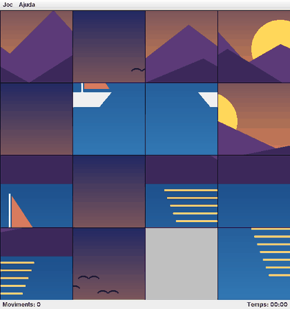
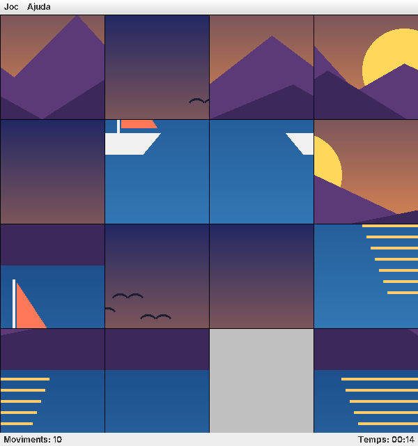
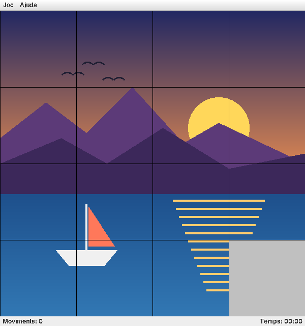

# Sliding Puzzle

A sliding puzzle game (*Trencaclosques*) written in Java with Swing. You pick an image and a board size, shuffle the tiles and put the picture back together by sliding them into the empty space.

Built for the Programming II course (*Programació II*) of the Computer Engineering degree at the University of the Balearic Islands (UIB), 2024-25. The interface is in Catalan.



## Features

- **Any image, any size:** at start-up you choose the board size, from 2×2 to 10×10, and an image, which is cut into tiles automatically.
- **Two ways to play:** with the keyboard (W, A, S, D or the arrow keys) or with the mouse, by clicking a tile next to the empty space.
- **Move counter and timer**, which start when you shuffle the board.
- **Statistics for each board size**, kept between games: games played, plus best and average time and moves.
- **Sound effects** for moves and for solving the puzzle.
- **Menu** to shuffle, solve, see the statistics and read the help.

| Shuffled | Solved |
|---|---|
|  |  |

## Code structure

| Class | Role |
|---|---|
| `Trencaclosques` | Main window: menus, keyboard and mouse input, move counter and timer |
| `Puzzle` | The board, kept as a matrix of tile values (the model) and a matrix of tiles (the view); shuffling, solving and moving |
| `Casella`, `Imatge` | A tile and the piece of the image it shows |
| `ConfiguradorPuzzle` | Start-up dialog for the board size and the image |
| `Direccio` | Maps keys to directions |
| `Stats` | Saves and loads the statistics in `stats.properties` |
| `Ruidos` | Sound effects |
| `MissatgeAjuda`, `MissatgeFiJoc` | Help window and end-of-game window |

## Run it

Requires Java 21. From the project folder (on Windows, Git Bash works):

```bash
javac -encoding UTF-8 -d out src/trencaclosques/*.java
cp -r src/ruidos out/
java -cp out trencaclosques.Trencaclosques
```

The image chooser opens the `imatges/` folder, which includes a sample picture drawn for this repository. The project can also be opened directly in NetBeans.

## Limitations

- Shuffling swaps tiles at random instead of making random legal moves, so about half of the shuffled boards cannot be solved. Shuffling with legal moves, or checking the parity of the permutation, would fix it.
